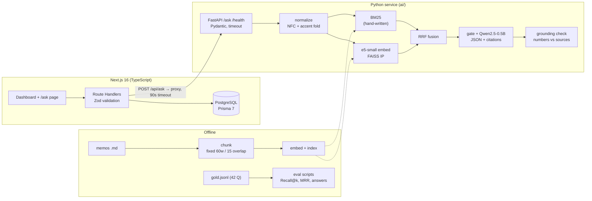

# StartupFlow + Deal Memo Copilot

**A deal-pipeline tracker for early-stage investors, extended with a bilingual
(Vietnamese/English) RAG assistant whose retrieval, grounding and latency are measured
rather than claimed.**

Investment teams keep startup notes as free-text memos. Finding "what valuation is
PayNest asking?" or "SoKa Lend ứng trước bao nhiêu %?" means opening each memo. The
Copilot answers from the memos with citations, says "not found" when they do not
contain the answer, and flags numbers the sources do not support.

> **Data disclaimer:** the 20 deal memos in `ai/data/corpus/` are **synthetic**. They
> are fictional companies written by hand for this project
> (`ai/scripts/make_corpus.py`). All results below are on this small corpus and do not
> show how the system performs on real-world documents.

## Architecture



## Tech stack and why

| Layer | Choice | Why | Alternative considered |
|---|---|---|---|
| Web/API | Next.js 16 Route Handlers + Zod | one TS codebase, runtime validation at the trust boundary | Express |
| DB | PostgreSQL + Prisma 7, CHECK constraints | invariants enforced in the DB as well as in Zod | SQLite |
| AI service | Python + FastAPI + Pydantic | the ML ecosystem is Python; schemas validate both HTTP input and LLM output | serving from Node |
| Embeddings | `intfloat/multilingual-e5-small` (118M, 384-d) | supports Vietnamese, runs on CPU, ~470 MB | `bge-m3` (better, 2.2 GB) |
| Vector search | FAISS `IndexFlatIP` (+ a numpy version for teaching) | exact search is fine for 75 chunks; same API as ANN indexes | Qdrant (worth it at more than ~100k chunks or with filters) |
| Lexical search | BM25 written by hand | every term of the formula is visible and tested | `rank_bm25`, Elasticsearch |
| Fusion | Reciprocal Rank Fusion | no score calibration needed between BM25 and cosine | weighted score sum |
| Generator | `Qwen/Qwen2.5-0.5B-Instruct`, greedy, CPU | free, local, reproducible; no API key | 7B via vLLM/Ollama, or a hosted API |
| Tests/CI | Vitest, pytest, ruff, GitHub Actions | the CI path is model-free, so it is fast | — |

LangChain/LlamaIndex are deliberately not used: each step is a small function, so it can
be explained and tested on its own.

## Quickstart

```bash
cp .env.example .env && docker compose up -d db && npm ci && npx prisma migrate deploy
```
```bash
npm run dev                                   # web on :3000
```
```bash
cd ai && python3 -m venv .venv && .venv/bin/pip install torch==2.15.0 --index-url https://download.pytorch.org/whl/cpu && .venv/bin/pip install -r requirements.txt && .venv/bin/pip install -e . --no-deps
```
```bash
cd ai && .venv/bin/uvicorn startupflow_ai.api:app --port 8000   # first start downloads ~1.5 GB of models
```

Then open http://localhost:3000/ask. Tests: `npm test` and `cd ai && .venv/bin/pytest`.

## Evaluation

**Gold set:** `ai/data/eval/gold.jsonl` has 42 hand-written questions: 32 answerable and
10 with no answer in the corpus (including an out-of-domain question and a
prompt-injection attempt). There are 20 Vietnamese and 22 English questions; 4 are
cross-lingual and 3 are typed without diacritics.
A retrieved chunk counts as **relevant** if it is from the gold memo *and* contains the
gold evidence string, so the label does not depend on the chunking strategy.

### Retrieval ablation (`python eval/run_retrieval_eval.py`, 32 answerable questions)

| Config | #chunks | Recall@1 | Recall@3 | Recall@5 | MRR@10 |
|---|---|---|---|---|---|
| fixed+bm25_raw | 75 | 0.812 | 0.969 | 0.969 | 0.880 |
| fixed+bm25_fold | 75 | 0.844 | 0.938 | 0.969 | 0.886 |
| fixed+bm25_fold_bigram | 75 | 0.812 | 0.938 | 0.969 | 0.876 |
| fixed+dense | 75 | 0.750 | 0.875 | 1.000 | 0.844 |
| fixed+hybrid | 75 | 0.781 | 0.969 | 1.000 | 0.872 |
| fixed30+bm25_raw | 151 | 0.750 | 0.812 | 0.875 | 0.801 |
| fixed30+bm25_fold | 151 | 0.781 | 0.844 | 0.906 | 0.836 |
| fixed30+bm25_fold_bigram | 151 | 0.781 | 0.844 | 0.906 | 0.836 |
| fixed30+dense | 151 | 0.562 | 0.812 | 0.844 | 0.692 |
| fixed30+hybrid | 151 | 0.594 | 0.906 | 0.938 | 0.756 |
| heading+bm25_raw | 140 | 0.719 | 0.875 | 0.906 | 0.794 |
| heading+bm25_fold | 140 | 0.750 | 0.875 | 0.938 | 0.827 |
| heading+bm25_fold_bigram | 140 | 0.781 | 0.906 | 0.938 | 0.846 |
| heading+dense | 140 | 0.625 | 0.812 | 0.906 | 0.724 |
| heading+hybrid | 140 | 0.688 | 0.844 | 0.969 | 0.790 |

### Recall@3 by question type

| Config | crosslingual (n=4) | distractor (n=2) | factual (n=23) | no_diacritics (n=3) |
|---|---|---|---|---|
| fixed+bm25_raw | 0.75 | 1.00 | 1.00 | 1.00 |
| fixed+bm25_fold | 0.50 | 1.00 | 1.00 | 1.00 |
| fixed+bm25_fold_bigram | 0.50 | 1.00 | 1.00 | 1.00 |
| fixed+dense | 0.75 | 1.00 | 0.96 | 0.33 |
| fixed+hybrid | 0.75 | 1.00 | 1.00 | 1.00 |
| fixed30+bm25_raw | 0.25 | 0.50 | 0.96 | 0.67 |
| fixed30+bm25_fold | 0.25 | 0.50 | 0.96 | 1.00 |
| fixed30+bm25_fold_bigram | 0.25 | 0.50 | 0.96 | 1.00 |
| fixed30+dense | 0.25 | 1.00 | 0.96 | 0.33 |
| fixed30+hybrid | 0.75 | 1.00 | 1.00 | 0.33 |
| heading+bm25_raw | 0.50 | 1.00 | 0.96 | 0.67 |
| heading+bm25_fold | 0.25 | 1.00 | 0.96 | 1.00 |
| heading+bm25_fold_bigram | 0.50 | 1.00 | 0.96 | 1.00 |
| heading+dense | 0.75 | 1.00 | 0.87 | 0.33 |
| heading+hybrid | 0.50 | 1.00 | 0.96 | 0.33 |

Takeaways:
- **Hybrid is the most robust config, not a big winner.** `fixed+hybrid` ties for best
  Recall@3 (0.969, with raw BM25) and for best Recall@5 (1.000, with dense), and it is the
  only config where no question type collapses (Recall@3: accent-less 1.00,
  cross-lingual 0.75). BM25 alone has the best Recall@1/MRR, because the questions name
  the company explicitly.
- **BM25 and dense fail on different questions.** Accent-less Vietnamese queries break
  dense retrieval (q06/q17: rank 4 with fixed chunks, not in the top 10 with heading
  chunks), while folded BM25 ranks them 1st. Cross-lingual queries break BM25 (q32: not
  found) but not dense (rank 2).
- **Chunk size mattered more than boundaries.** The 60-word fixed window beat heading
  chunks. A 30-word fixed run (same size as a section) came out roughly level with heading
  chunks (better Recall@3, worse Recall@1/MRR), so most of the gain comes from more
  context per chunk, not from where it is cut.
- Accent folding helps BM25 slightly; syllable bigrams did not help consistently.
- **Re-ranker: not run.** Recall@1 (0.781) is much lower than Recall@5 (1.000), which is
  the gap a cross-encoder is designed to close. It is the next experiment.

### Answer quality (`python eval/run_answer_eval.py`)

Default pipeline: `fixed+hybrid`, top-4, `Qwen2.5-0.5B-Instruct` on CPU, greedy decoding.
"Accuracy" is a strict keyword match against the gold answer (accent/case-insensitive).
Raw per-question outputs for manual review are in `ai/results/answers_v2.jsonl`.

| Metric | v1 (baseline) | v2 (citation repair + few-shot) | v3 (+ verification layer, replayed) |
|---|---|---|---|
| Evidence in top-4 context (answerable) | 32/32 | 32/32 | 32/32 |
| Answer accuracy (answerable) | 15/32 = 0.47 | 17/32 = 0.53 | **17/32 = 0.53** |
| False abstention (answerable) | 16/32 | 6/32 | 8/32 |
| Correct abstention (no-answer) | **8/10** | 5/10 | 6/10 |
| Answer precision (correct / answered) | **15/18 = 0.83** | 17/31 = 0.55 | 17/28 = 0.61 |
| Citation precision (mean) | 0.29 | 0.54 | — |
| LLM-judge (same 0.5B) says "supported" | 17/18 | 27/31 | — |
| LLM-judge agreement with keyword label | 0.78 | 0.48 | — |

How each version was produced:
- **v1 → v2** (`python eval/run_answer_eval.py`): failure analysis showed that 16/32 "not
  found" answers were in fact correct answers thrown away by strict parsing. The 0.5B
  model wrote `citations` as strings, objects or `[passage numbers 1, 2]`. The fix adds a
  few-shot example, coerces malformed citations, and infers citations post-hoc (flagged)
  when they are missing.
- **v2 → v3** (`python eval/replay_verification.py results/answers_v2.jsonl`): the new
  post-generation checks re-attribute citations to the passage that holds the numbers,
  abstain on an entity mismatch, and reject degenerate answers. Generation is greedy and
  the prompt did not change, so v3 = v2 outputs + new checks, **replayed offline**
  instead of regenerated.

**What this shows (honestly):** retrieval is not the bottleneck (32/32), the 0.5B
generator is. Fixing the parser moved the system from *cautious and precise* (v1,
precision 0.83) to *more coverage, less precise* (v3, 0.61). For a finance assistant v1's
operating point is arguably safer. The real fix is a stronger generator (see Future work),
not more rules. The 0.5B judge says "supported" for almost everything, so it is not used
for any decision.

### Failure analysis

| Case | What happened | Root cause | Fix tried | Result |
|---|---|---|---|---|
| q02, q03, q07 … (16 in v1) | correct answer, returned "not found" | 0.5B model wrote citations in the wrong shape; strict schema rejected the whole answer | few-shot example + citation coercion + post-hoc attribution | false abstention 16 → 6 |
| q36 (no-answer) | "ShipNhanh revenue 2025 = 48 tỷ" | number copied from **HọcVui's** memo, which was also retrieved | entity check on cited passages | now abstains |
| q03, q04, q14, q20 | correct answer flagged by the numeric check | model cited the wrong passage number | re-attribute citation to the passage containing the numbers | flags removed, citations fixed |
| q15, q17 | answer `"[2]"` / echo of the question | degenerate generation | degenerate-output rule | now abstain |
| q07, q10, q19 | answers a *different* fact from the right memo (ARR → price; placement rate → fundraising) | 0.5B model's weak instruction following | none that works with rules; needs a stronger generator | **open** |
| q33, q34, q37 (no-answer) | "EBITDA 9%", "46 nhân sự", "raising 8M USD" given for questions the memos cannot answer | same: semantic mismatch, and the number exists in context | — | **open** |
| q06, q17, q31 (accent-less) | 0/3 correct end-to-end although retrieval finds the evidence | generator copes poorly with accent-less Vietnamese prompts | — | **open** |

## Performance

Measured on a 12-core WSL2 laptop CPU (no GPU, 7 GB RAM). **Other projects' jobs were
running at the same time (load average 11–15)**, so absolute numbers are pessimistic. The
cache comparison is still fair: same machine, same minute.

| What | How | p50 | p95 | Throughput |
|---|---|---|---|---|
| Retrieval (embed + FAISS + BM25 + RRF), cache **off** | `python eval/load_test.py --mode retrieval` (42 questions × 5) | 83 ms | 262 ms | 8.9 req/s |
| Retrieval, query-embedding LRU cache **on** | same run, cache enabled | 0.2 ms | 169 ms | 35.8 req/s |
| End-to-end `POST /ask`, concurrency 1 | `python eval/load_test.py --mode http --n 10 --concurrency 1` | 28.3 s | 60.3 s | 0.03 req/s |
| End-to-end `POST /ask`, concurrency 2 | `... --concurrency 2` | 44.6 s | 60.1 s | 0.04 req/s |

- The cache benchmark repeats each question 5 times, so the hit rate (80%) is set by the
  benchmark design, not by real traffic.
- **Generation is >95% of latency** (sample request: retrieve 352 ms, generate 24.0 s).
- **4 of 21 HTTP requests hit the 60 s timeout and got 504**: counted from the server log
  with `grep -c '"POST /ask HTTP/1.1" 504'`. The timeout did its job, but it is too tight
  for this machine under load.
- Concurrency 2 does not raise throughput: one CPU-bound model behind a lock only adds
  queueing time. This is exactly the problem continuous batching (vLLM) and a GPU solve.

## DL fundamentals: fine-tuning a query router in PyTorch

`ai/router/` holds a 3-class router (`memo_question` / `out_of_domain` /
`prompt_injection`) that could run before RAG. It compares two models: full fine-tuning
of `multilingual-e5-small` (encoder + linear head, hand-written PyTorch loop, AdamW,
warmup, grad clipping, mean pooling) and a frozen-encoder + logistic-regression baseline.
Data is **template-generated** (`router/data.py`). To keep the test honest, it uses
companies and templates that never appear in train, plus 30 free-form hand-written
queries. Train/val are split *before* upsampling, so no sentence is duplicated across
splits.

Run: `cd ai && python router/data.py && python router/train.py`

| Split | n | Frozen e5 + LogReg | Fine-tune run 1 (one lr 3e-5, 3 ep) | Fine-tune run 2 (head 1e-3 / enc 3e-5, 8 ep, best val) |
|---|---|---|---|---|
| val (same templates as train) | 30 | 0.923 | 0.232 | **1.000** |
| test_heldout (new companies + templates) | 67 | **0.903** | 0.326 | 0.878 |
| test_handwritten (free-form) | 30 | **0.899** | 0.232 | 0.789 |

(macro-F1; full metrics and confusion matrices in `ai/results/router*.md`)

What I learned:
1. **Run 1 collapsed to the majority class.** The randomly initialised head got the same
   tiny learning rate as the pretrained encoder, and 36 steps were not enough. Separate
   learning rates per parameter group fixed training.
2. **Run 2 overfits to template style.** It is perfect on val but worse than the frozen
   baseline on both shifted test sets (injection recall on hand-written queries: 5/10).
   With about 200 examples, updating 118M parameters memorises phrasing, while a linear
   probe on frozen embeddings generalises better.
3. **A validation set drawn from the training distribution can mislead.** Model selection
   needs a val set that looks like production traffic. Next steps: freeze lower layers or
   use LoRA, add real paraphrases, and stop selecting on template-only val.

The router is an experiment and is **not** wired into the serving path.

## Limitations (honest)

- 20 synthetic memos (~4k words) is tiny, so the metrics have wide error bars (one
  question = 3 points of Recall).
- The abstention threshold and the default config were chosen on the same 42 questions
  they are reported on (no held-out split).
- Keyword-match accuracy is a proxy; a manual review of `ai/results/answers_v2.jsonl` (not done yet, see below)
  is the ground truth for answer quality.
- A 0.5B generator on CPU is slow and imprecise. It was chosen for $0 cost and no GPU,
  not for quality.
- No authentication on either API.
- **Human review not done yet.** The owner of this repo still needs to label 10–15 answers in
  `ai/results/answers_v2.jsonl` by hand and report agreement with the keyword metric.
- The full v3 pipeline was evaluated by offline replay; a fresh end-to-end rerun is pending.

## Future work

1. Cross-encoder re-ranking (e.g. `bge-reranker-v2-m3`) on the top 20.
2. Vietnamese word segmentation for BM25; `bge-m3` embeddings.
3. Stronger generator and judge (7B via vLLM, or a hosted API) plus 30 human labels to
   calibrate the judge.
4. Router: LoRA or partial freezing, real paraphrase data, then wire it in front of RAG.
5. OCR ingestion for PDF pitch decks.

## Repo map

```
src/                 Next.js app (dashboard, CRUD API, /ask proxy) + Vitest tests
prisma/              schema + migrations (incl. CHECK constraints)
ai/startupflow_ai/   text, chunking, bm25, dense, hybrid, retriever, generate, grounding, pipeline, api
ai/eval/             retrieval eval, answer eval, verification replay, load test
ai/router/           PyTorch fine-tuning of the query router (data + train)
ai/data/             synthetic corpus + gold.jsonl
ai/results/          committed outputs of the eval scripts
docs/fundamentals.md concepts explained in this project's terms
```
